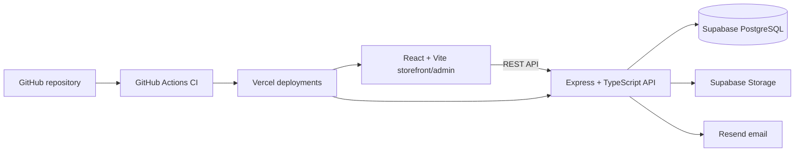

<p align="center">
  
</p>

<h1 align="center">CommerceLab</h1>

<p align="center">
  A full-stack commerce application with a customer storefront, persistent cart and checkout,
  protected admin tools, inventory management, order workflows, image storage, transactional
  email, and checkout idempotency.
</p>

<p align="center">
  <a href="https://commercelab-9v3x.vercel.app"><strong>Live Storefront</strong></a>
  ·
  <a href="https://commercelab-9v3x.vercel.app/admin/login"><strong>Admin Demo</strong></a>
  ·
  <a href="https://commercelab-seven.vercel.app/health"><strong>API Health</strong></a>
</p>

## Demo access

| Area | Link / credentials |
| --- | --- |
| Storefront | https://commercelab-9v3x.vercel.app |
| Admin login | https://commercelab-9v3x.vercel.app/admin/login |
| Username | `admin` |
| Password | `admin` |
| Backend health | https://commercelab-seven.vercel.app/health |

> **Shared demo environment:** Admin changes affect the shared live catalogue and order data.  
> The checkout is a demo flow and does not process a real payment.

## What can be tested

### Customer experience

- Browse a responsive product catalogue.
- Search products and filter by stock availability.
- Open product detail pages with ordered image galleries.
- Select quantities while respecting available stock.
- Add products to a persistent cart backed by `localStorage`.
- Change quantities, remove products, and review totals.
- Complete a demo checkout with shipping information.
- Receive a generated order number and confirmation email.
- See stock update after a successful order.

### Admin experience

- Sign in through a protected admin route.
- Create, edit, activate, deactivate, and delete products.
- Upload multiple product images to Supabase Storage.
- Delete images with confirmation.
- Reorder images using drag and drop; the first image becomes the main image.
- Reorder products to control storefront merchandising.
- View all customer orders and filter them by status.
- Inspect order details, customer data, shipping address, items, and historical prices.
- Move orders through `confirmed`, `processing`, `shipped`, and `cancelled`.
- Restore inventory exactly once when an order is cancelled.

## Engineering highlights

- **Backend as source of truth:** Checkout pricing and stock are re-read from PostgreSQL instead of trusting browser values.
- **Transactional checkout:** Order creation, order items, and inventory reduction commit together or roll back together.
- **Atomic stock protection:** Conditional SQL updates prevent inventory from becoming negative during concurrent purchases.
- **Idempotent orders:** A unique checkout key prevents double-clicks or network retries from creating duplicate orders or reducing stock twice.
- **Historical order snapshots:** Order items store the purchased product name, slug, quantity, and unit price so past orders remain accurate after catalogue changes.
- **Protected administration:** Signed HttpOnly session cookies secure both React admin routes and backend admin endpoints.
- **Persistent UI state:** Cart totals and quantities are derived with React state and `useMemo`, then persisted in `localStorage`.
- **Media management:** Supabase Storage is used for durable uploads instead of external image links.
- **Continuous integration:** GitHub Actions builds both frontend and backend on pull requests and pushes to `main`.
- **Environment-based deployment:** Separate Vercel projects deploy the frontend and Express API from one monorepo.

## Architecture



## Tech stack

### Frontend

- React 19
- TypeScript
- Vite 8
- Tailwind CSS 4
- React Router
- DnD Kit
- React Context, `useState`, `useEffect`, and `useMemo`

### Backend

- Node.js
- Express 5
- TypeScript
- Prisma ORM 8 RC
- PostgreSQL through Supabase
- Supabase Storage
- Multer
- Resend

### Infrastructure

- Vercel
- GitHub Actions
- Supabase PostgreSQL and Storage

## Repository structure

```text
commercelab/
├── backend/
│   ├── migrations/
│   └── src/
│       ├── auth/
│       ├── config/
│       ├── email/
│       ├── middleware/
│       ├── prisma/
│       └── routes/
├── frontend/
│   ├── public/
│   └── src/
│       ├── api/
│       ├── components/
│       ├── context/
│       └── pages/
└── .github/
    └── workflows/
```

## Local setup

### Prerequisites

- Node.js 24+
- npm
- A Supabase project with PostgreSQL and a public Storage bucket
- A Resend API key for confirmation emails

### 1. Clone the repository

```bash
git clone https://github.com/GHichem/commercelab.git
cd commercelab
```

### 2. Install dependencies

```bash
cd backend
npm ci

cd ../frontend
npm ci
```

### 3. Configure the backend

Create `backend/.env`:

```env
DATABASE_URL=postgresql://...
DIRECT_URL=postgresql://...

SUPABASE_URL=https://your-project.supabase.co
SUPABASE_SECRET_KEY=your-server-side-secret
SUPABASE_STORAGE_BUCKET=product-images

ADMIN_USERNAME=admin
ADMIN_PASSWORD=admin
ADMIN_SESSION_SECRET=replace-with-a-long-random-value

RESEND_API_KEY=re_...
RESEND_FROM_EMAIL=CommerceLab <onboarding@resend.dev>

FRONTEND_URL=http://localhost:5173
NODE_ENV=development
```

Never commit real secrets.

### 4. Configure the frontend

Create `frontend/.env.local`:

```env
VITE_API_URL=http://localhost:3000
```

### 5. Apply database migrations

```bash
cd backend
npx prisma contract emit
npx prisma db migrate
npx prisma migration status
```

### 6. Start the applications

Backend:

```bash
cd backend
npm run dev
```

Frontend:

```bash
cd frontend
npm run dev
```

Open:

```text
http://localhost:5173
```

## Useful scripts

### Backend

```bash
npm run dev
npm run build
npm start
npm run contract:emit
```

### Frontend

```bash
npm run dev
npm run build
npm run lint
npm run preview
```

## API overview

### Public

```text
GET    /health
GET    /products
GET    /products/:slug
POST   /orders
```

### Admin

```text
POST   /admin/auth/login
GET    /admin/auth/me
POST   /admin/auth/logout

GET    /admin/products
POST   /admin/products
PUT    /admin/products/:id
DELETE /admin/products/:id

POST   /admin/products/:productId/images
PUT    /admin/products/:productId/images/order
DELETE /admin/products/:productId/images/:imageId

GET    /admin/orders
GET    /admin/orders/:id
PATCH  /admin/orders/:id/status
```

## Deployment

The monorepo is deployed as two Vercel projects:

- `frontend/` → Vite frontend
- `backend/` → Express API

The frontend uses `VITE_API_URL` to reach the API. The backend uses `FRONTEND_URL` for CORS.

## Production considerations

CommerceLab is a portfolio/demo application. Before using it as a real store, the following should be replaced or expanded:

- public demo credentials
- a production identity provider and role model
- a real payment provider such as Stripe
- verified transactional email domain
- rate limiting and abuse protection
- automated integration and end-to-end tests
- observability, structured logging, and backups

## Author

Built by [Hichem Guettat](https://github.com/GHichem) as a full-stack portfolio project for junior and working-student software development roles.
